  

## 🧑‍💻 Sobre mí

Soy **Pablo**, de Torrent (Valencia). Mezclo dos mundos: los **sistemas y las redes**, donde aprendí a montar, reparar y configurar (CFGM SMR), y el **desarrollo de software**, que estudio ahora en el **CFGS DAM** del IES Abastos. Ya he trabajado como **desarrollador web en Atenas** y como **técnico TIC**, y mi proyecto personal más grande es **EGG WARS**, un shooter 3D online hecho desde cero.

---

## 🚀 Proyecto estrella · EGG WARS

**Shooter 3D multijugador de huevos en el navegador**, hecho desde cero con un servidor autoritativo en Node.js.

---

## 💼 Experiencia

---

## 🛠️ Tecnologías

  

☕ Java y POO · 🌐 Web y WordPress · 🗄️ SQL y bases de datos · 🖧 Hardware, Windows, Linux y redes (Cisco Packet Tracer · CCNA 1)

---

## 🎓 Formación e idiomas

---

## 🧩 Más proyectos

Juegos de consola: <a href="https://github.com/campayoo/JuegoDelTesoro">Juego del Tesoro</a> · <a href="https://github.com/campayoo/AhorcadoJugadores">Ahorcado de futbolistas</a> · <a href="https://github.com/campayoo/ArbolNavidad">Árbol de Navidad</a>

---

## 📊 Actividad en GitHub

---

<b>🇬🇧 English version</b>

 

Hi! I'm **Pablo Campayo Viñes**, an IT student from Torrent (Valencia, Spain). I hold a vocational degree in **Microcomputer Systems and Networks (SMR, EQF 4)** and I'm currently studying **Cross-Platform Application Development (DAM, EQF 5)**, so I have a solid foundation in both systems and networks and in software development.

**I'm looking for an Erasmus+ internship** where I can apply what I've learned, gain real experience in a professional environment and keep growing as a developer. I'm motivated, curious and a quick learner, and I enjoy solving problems and working in a team.

- 💼 **Experience:** web developer at **CrowdPolicy (Athens, Greece)** — WordPress website and chatbot · ICT technician at **RS Turia** — maintenance, support and WordPress · crew member (trainer) at **McDonald's**
- 🥚 **Featured project:** [EGG WARS](https://github.com/campayoo/EggWars) — 3D multiplayer browser shooter with an authoritative Node.js server, anti-cheat, A* bots, PostgreSQL accounts and 225 automated tests ([play online](https://eggwars-plai.onrender.com))
- 🛠️ **Skills:** Java & OOP · JavaScript · HTML/CSS · SQL · WordPress · Windows & Linux · networking (Cisco CCNA 1)
- 🗣️ **Languages:** Spanish and Catalan (native) · **English B2** · French A2

 

**¿Te encaja mi perfil para unas prácticas?** Tienes todo en [**campayoo.github.io**](https://campayoo.github.io) 🧡

