  

## 🧑‍💻 Sobre mí

Soy **Pablo**, de Torrent (Valencia). Empecé montando y reparando ordenadores en el ciclo de **Sistemas Microinformáticos y Redes**, y ahora estudio **Desarrollo de Aplicaciones Multiplataforma** en el IES Abastos. En clase programo sobre todo en Java; por mi cuenta, en JavaScript y Node.js.

Me gusta entender cómo funcionan las cosas por dentro, ya sea una red, una base de datos o el servidor de un juego.

---

## 💼 Experiencia

---

## 🧩 Proyectos

EGG WARS: <a href="https://eggwars-plai.onrender.com">jugar online</a> · <a href="https://campayoo.github.io/EggWars/">guía del juego</a> &nbsp;|&nbsp; Consola: <a href="https://github.com/campayoo/JuegoDelTesoro">Juego del Tesoro</a> · <a href="https://github.com/campayoo/AhorcadoJugadores">Ahorcado</a> · <a href="https://github.com/campayoo/ArbolNavidad">Árbol de Navidad</a>

---

## 🛠️ Tecnologías

  

☕ Java y POO · 🌐 Web y WordPress · 🗄️ SQL · 🖧 Hardware, Windows, Linux y redes (Cisco Packet Tracer · CCNA 1) · ahora aprendiendo Kotlin y Android

---

## 🎓 Formación e idiomas

---

## 📊 Actividad

---

<b>🌍 English version</b>

 

Hi! I'm **Pablo**, an IT student from Torrent (Valencia, Spain). I finished a vocational degree in **Microcomputer Systems and Networks** and I'm now studying **Cross-Platform Application Development**. I mostly write Java at school and JavaScript/Node.js on my own.

- 💼 Web developer at **CrowdPolicy** (Athens) · ICT technician at **RS Turia** · crew trainer at **McDonald's**
- 🧩 Projects: a 3D online browser game, a Champions League simulator in Java and a web platform about the SDGs
- 🗣️ Spanish and Valencian (native) · **English B2** · French A2

Open to internships, in Spain or abroad.

