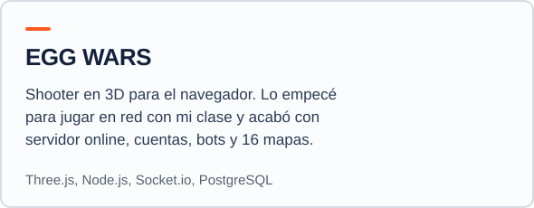
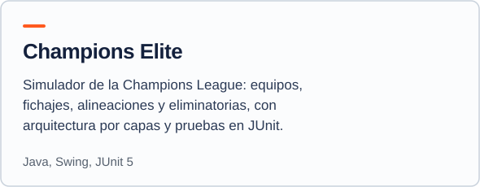
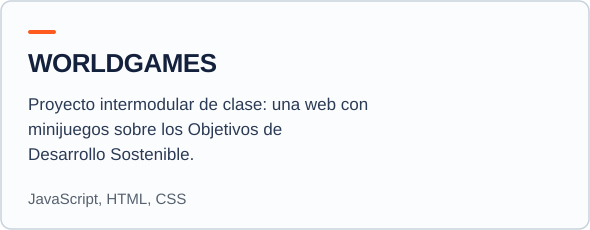
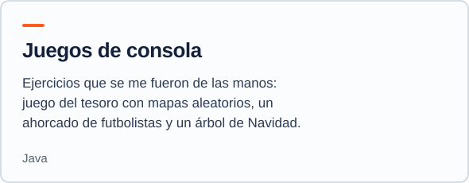

Hola, soy Pablo. Estudio **Desarrollo de Aplicaciones Multiplataforma** en el IES Abastos (Valencia) después de terminar el ciclo de **Sistemas Microinformáticos y Redes**. Empecé montando y reparando ordenadores, y ahora paso casi todo el tiempo programando: Java en clase, JavaScript y Node.js por mi cuenta.

Me gusta entender cómo funcionan las cosas por dentro, ya sea una red, una base de datos o el servidor de un juego.

Web personal: **[campayoo.github.io](https://campayoo.github.io)**

## Proyectos

## Experiencia

**McDonald's**, Torrent · 2025 – hoy  
Personal de equipo y entrenador. Atención al cliente, pedidos, postres y bebidas; aquí se aprende a priorizar cuando todo pasa a la vez.

**RS Turia**, Riba-roja de Túria · 2025  
Técnico TIC. Mantenimiento de los equipos, soporte a los usuarios y una web para la empresa en WordPress.

**CrowdPolicy**, Atenas (Grecia) · 2025  
Desarrollador web durante un mes. Una web completa en WordPress (estructura, tema y plugins) y un chatbot para las preguntas más habituales.

## Formación

- **CFGS Desarrollo de Aplicaciones Multiplataforma**, IES Abastos · 2025 – hoy
- **CFGM Sistemas Microinformáticos y Redes**, IES Serra Perenxisa · 2023 – 2025 (incluye CCNA 1 de Cisco)

## Con lo que trabajo

Ahora estoy aprendiendo TypeScript y React. Idiomas: español y valenciano, inglés B2 (Cambridge) y francés A2.

---

**In English:** I'm Pablo, a software development student from Valencia, Spain (B2 English). I build things in Java and JavaScript, from desktop apps to a multiplayer browser game. I'm finishing my degree and open to internships, in Spain or abroad.
